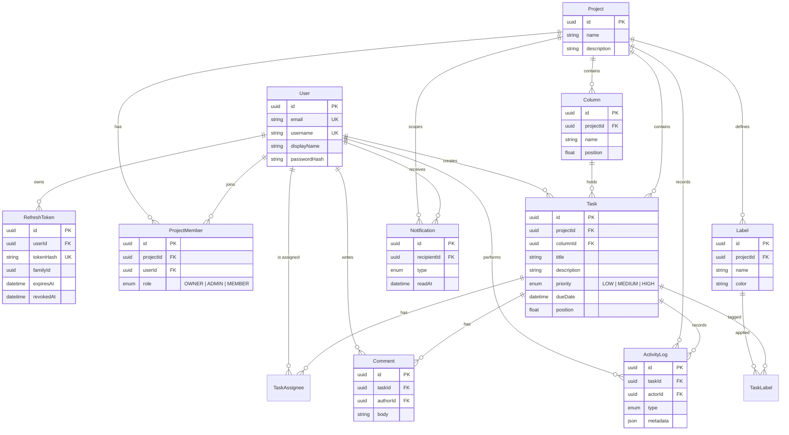

# Crewlane

Collaborative Kanban project management for small teams. Create shared projects, organize work
on drag-and-drop boards, assign tasks to teammates, discuss them with @mentions, and see every
change from your crew the moment it happens.

## Features

- **Accounts** – register, log in, log out. Short-lived access tokens with rotating refresh
  tokens in httpOnly cookies; refresh-token reuse revokes the whole session family.
- **Projects & members** – create, rename and delete projects; invite teammates by email or username with
  `OWNER`, `ADMIN` or `MEMBER` roles; change roles or remove members.
- **Boards** – default To Do / In Progress / Done columns; add, rename, reorder and delete
  columns; drag tasks within and across columns (mouse, touch and keyboard).
- **Tasks** – title, description, priority, due date, assignees and labels; search and filter
  the board by text, assignee, priority and label.
- **Comments** – threaded discussion per task with @mention autocomplete.
- **Activity log** – every task change recorded and shown in the task modal.
- **Real-time** – board changes, comments and notifications stream to every open session via
  Supabase Realtime private channels, authorized by Postgres RLS.
- **Notifications** – assignment, mention and comment notifications with an unread badge.

## Tech stack

| Layer         | Choice                                                         |
| ------------- | -------------------------------------------------------------- |
| Framework     | Next.js 16 (App Router), React 19, TypeScript (strict)         |
| UI            | Tailwind CSS v4, dnd-kit, TanStack Query v5                    |
| Data          | PostgreSQL on Supabase, Prisma ORM                             |
| Auth          | Custom JWT (jose, HS256) + bcrypt, httpOnly cookies            |
| Real-time     | Supabase Realtime broadcast on private channels                |
| Validation    | Zod 4 on every request body and route param                    |
| Testing       | Vitest (unit + integration against Postgres), Playwright (e2e) |
| Quality gates | ESLint, Prettier, Husky + lint-staged                          |

## Architecture

Crewlane follows Clean Architecture. Dependencies point inward: the domain knows nothing about
Next.js, Prisma or Supabase.

```
src/
├── core/
│   ├── domain/            # Entities, repository interfaces, domain services, events, errors
│   └── application/       # Use cases, authorization policies, Zod schemas, DTOs, ports
├── infrastructure/        # Prisma repositories, JWT/bcrypt, rate limiter, realtime, container
├── lib/api/               # Route handler wrapper, body parsing, central error mapping
├── app/
│   ├── api/               # Thin route handlers: parse → use case → respond
│   ├── (auth)/            # Login and register pages
│   └── (dashboard)/       # Projects list and project board
├── components/
│   ├── ui/                # Accessible primitives (Button, Modal, Dropdown, …)
│   └── features/          # Auth, board, task, comment, member, notification, layout
├── hooks/                 # TanStack Query hooks, optimistic updates, realtime subscriptions
├── lib/                   # Client utilities (http client, cache updaters, formatting)
└── types/                 # Shared client-side types
```

- **Use cases** receive only the dependencies they need (`Pick<AppDependencies, …>`), which keeps
  them unit-testable with in-memory fakes.
- **Composition root** – `infrastructure/container.ts` wires concrete adapters once per process.
- **Authorization** – `requireProjectMembership` answers 404 for unknown projects and 403 for
  non-members or insufficient roles, before any use case touches data.
- **API shape** – success responses are `{ "data": … }`; failures are
  `{ "error": { "message": "…", "code": "…" } }` with matching HTTP status codes.
- **Ordering** – columns and tasks use fractional positions, shared by server and client, so a
  move updates a single row; positions rebalance automatically when gaps get too small.
- **Optimistic UI** – board mutations update the cache immediately, roll back on failure, and
  ignore stale or self-originated realtime events.

### Real-time flow

1. A use case commits a change, then publishes an event to the `project:<id>` (or `user:<id>`)
   topic through the Supabase Realtime REST broadcast API using the service role.
2. The browser fetches a short-lived channel token from `/api/realtime/token`, signed with the
   Supabase JWT secret (`sub` = user id).
3. Supabase checks the RLS policies on `realtime.messages`, which call
   `private.is_project_member`, so only members can join a project channel.
4. The client merges the event into the TanStack Query cache.

No custom WebSocket server is involved, so the app runs entirely on serverless functions.

## Data model



`RateLimitBucket` (fixed-window counters keyed by action and client IP) stands alone. Row Level
Security is enabled on every public table; only the server, connecting through Prisma, reads them.

## API reference

All endpoints live under `/api`, accept and return JSON, and authenticate through the
`crewlane_access` cookie. Route parameters are validated as UUIDs.

### Auth

| Method | Path             | Description                                                 |
| ------ | ---------------- | ----------------------------------------------------------- |
| POST   | `/auth/register` | Create an account and start a session (5 per 10 min per IP) |
| POST   | `/auth/login`    | Start a session (10 per minute per IP)                      |
| POST   | `/auth/refresh`  | Rotate the refresh token and issue a new access token       |
| GET    | `/auth/refresh`  | Same, then redirect to `?next=` (used by the proxy)         |
| POST   | `/auth/logout`   | Revoke the refresh token family and clear cookies           |
| GET    | `/auth/me`       | Current user                                                |

### Projects and members

| Method | Path                                     | Access | Description                 |
| ------ | ---------------------------------------- | ------ | --------------------------- |
| GET    | `/projects`                              | user   | Projects you belong to      |
| POST   | `/projects`                              | user   | Create a project            |
| GET    | `/projects/:projectId`                   | member | Project details and members |
| PATCH  | `/projects/:projectId`                   | owner  | Rename or edit description  |
| DELETE | `/projects/:projectId`                   | owner  | Delete the project          |
| GET    | `/projects/:projectId/members`           | member | List members                |
| POST   | `/projects/:projectId/members`           | admin  | Invite by email or username |
| PATCH  | `/projects/:projectId/members/:memberId` | owner  | Change a member's role      |
| DELETE | `/projects/:projectId/members/:memberId` | admin  | Remove a member (or leave)  |

### Board, columns and labels

| Method | Path                           | Access | Description                       |
| ------ | ------------------------------ | ------ | --------------------------------- |
| GET    | `/projects/:projectId/board`   | member | Columns with ordered tasks        |
| POST   | `/projects/:projectId/columns` | admin  | Add a column                      |
| PATCH  | `/columns/:columnId`           | admin  | Rename a column                   |
| PATCH  | `/columns/:columnId/move`      | admin  | Reorder a column                  |
| DELETE | `/columns/:columnId`           | admin  | Delete a column (one must remain) |
| GET    | `/projects/:projectId/labels`  | member | List labels                       |
| POST   | `/projects/:projectId/labels`  | member | Create a label                    |

### Tasks, comments and activity

| Method | Path                         | Access | Description                                 |
| ------ | ---------------------------- | ------ | ------------------------------------------- |
| POST   | `/projects/:projectId/tasks` | member | Create a task in a column                   |
| GET    | `/tasks/:taskId`             | member | Task with assignees and labels              |
| PATCH  | `/tasks/:taskId`             | member | Update title, description, priority, labels |
| DELETE | `/tasks/:taskId`             | member | Delete a task                               |
| PATCH  | `/tasks/:taskId/move`        | member | Move to a column and index                  |
| PUT    | `/tasks/:taskId/assignees`   | member | Replace assignees (notifies new ones)       |
| GET    | `/tasks/:taskId/comments`    | member | List comments                               |
| POST   | `/tasks/:taskId/comments`    | member | Add a comment (notifies @mentions)          |
| PATCH  | `/comments/:commentId`       | author | Edit your comment                           |
| DELETE | `/comments/:commentId`       | author | Delete your comment                         |
| GET    | `/tasks/:taskId/activity`    | member | Activity history                            |

### Notifications and realtime

| Method | Path                             | Description                           |
| ------ | -------------------------------- | ------------------------------------- |
| GET    | `/notifications`                 | Latest notifications and unread count |
| PATCH  | `/notifications/:notificationId` | Mark one as read                      |
| POST   | `/notifications/read-all`        | Mark all as read                      |
| GET    | `/realtime/token`                | Short-lived Supabase channel token    |

### Example

```http
POST /api/projects/7c0e…/tasks
Content-Type: application/json

{ "columnId": "1f2a…", "title": "Write launch post", "priority": "HIGH" }
```

```json
{
  "data": {
    "task": { "id": "9b41…", "title": "Write launch post", "priority": "HIGH", "position": 3000 }
  }
}
```

```json
{ "error": { "message": "You are not a member of this project", "code": "FORBIDDEN" } }
```

## Local setup

Requirements: Node.js 20.9+ and PostgreSQL 15+ (local or Supabase).

```bash
npm install
cp .env.example .env          # fill in DATABASE_URL, DIRECT_URL and two JWT secrets
npx prisma migrate deploy
npm run db:seed               # demo users and a sample project
npm run dev
```

Generate JWT secrets with `openssl rand -base64 48`. Real-time updates need a Supabase project:
set the four `SUPABASE` variables and run `npm run db:realtime-policies` once. Without them the
app still works and simply skips live updates.

### Scripts

| Command                      | Purpose                                               |
| ---------------------------- | ----------------------------------------------------- |
| `npm run dev`                | Start the dev server                                  |
| `npm run build`              | Generate the Prisma client and build for production   |
| `npm run lint` / `typecheck` | ESLint and TypeScript checks                          |
| `npm run test:unit`          | Unit tests                                            |
| `npm run test:integration`   | API tests against `TEST_DATABASE_URL` (emptied first) |
| `npm run test:e2e`           | Playwright smoke test                                 |

## Deployment

The app is deployed on Vercel with Supabase Postgres.

1. Create a Supabase project and run `npx prisma migrate deploy` and
   `npm run db:realtime-policies` with `DIRECT_URL` pointing at the session pooler.
2. In Vercel, import the repository and set every variable from `.env.example`. Use the
   transaction pooler (port 6543, `?pgbouncer=true&connection_limit=1`) for `DATABASE_URL`.
3. Pick a function region close to the database.

## Limitations and future work

- Invitations require the teammate to already have an account; email invites are next.
- No file attachments, subtasks or due-date reminders yet.
- Rate limiting is per IP in Postgres; a shared cache would scale better under heavy load.
- Presence (who is viewing a board) would be a natural next use of Realtime.
