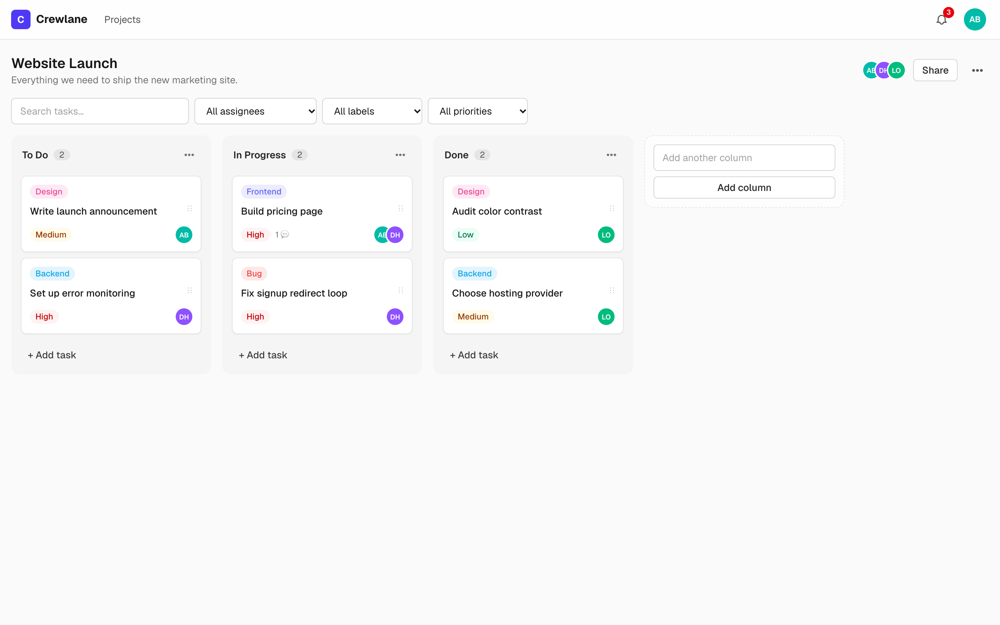
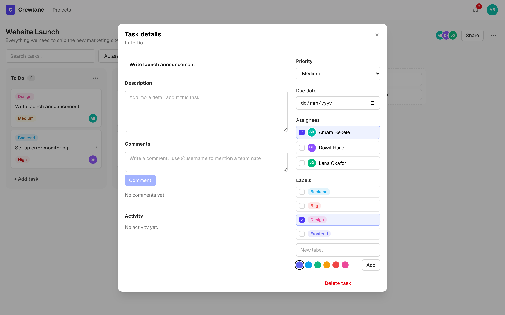
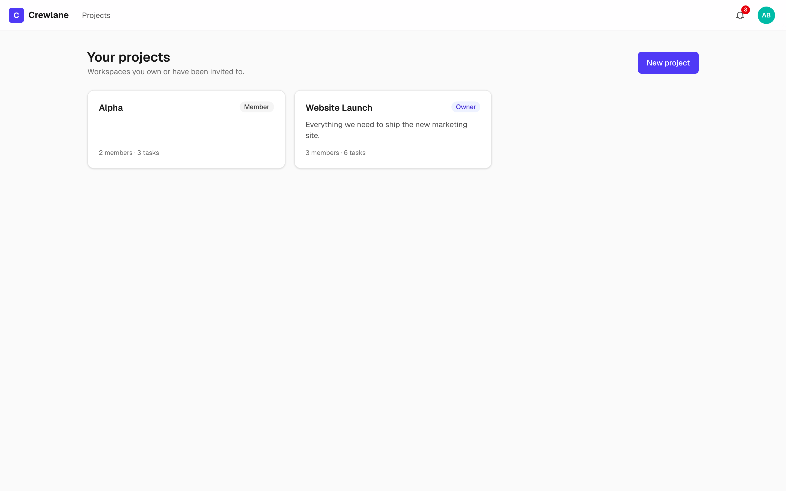
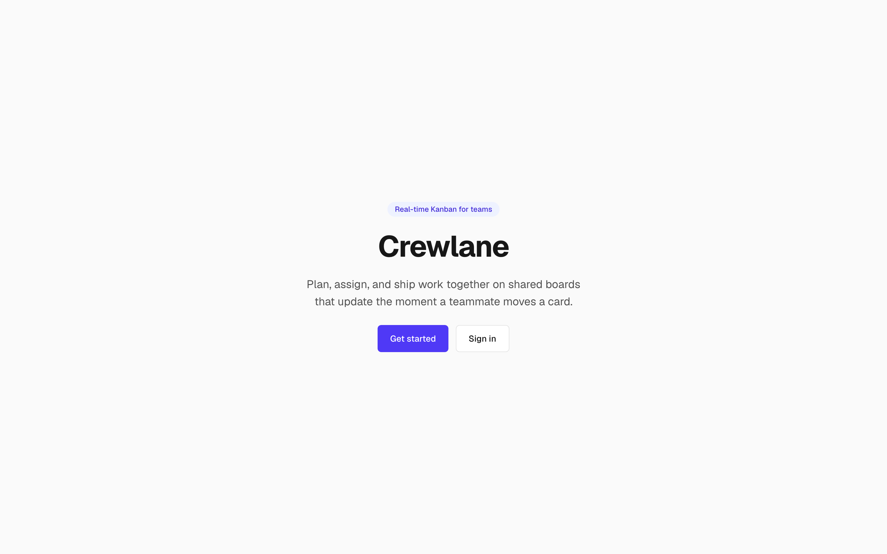
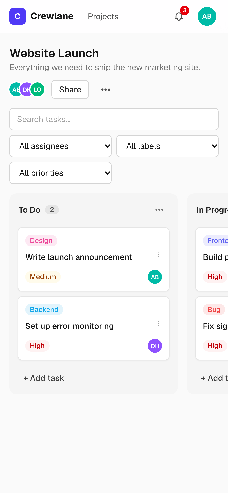

# Crewlane

Collaborative Kanban project management for small teams. Create shared projects, organize work
on drag-and-drop boards, assign tasks to teammates, discuss them with @mentions, and see every
change from your crew the moment it happens.

**Live demo:** https://crewlane-app.vercel.app

| Demo account         | Password        |
| -------------------- | --------------- |
| `amara@crewlane.dev` | `Crewlane#2026` |
| `dawit@crewlane.dev` | `Crewlane#2026` |
| `lena@crewlane.dev`  | `Crewlane#2026` |

Log in as two different users in two browsers (or a private window) to watch changes arrive
live.



## Contents

- [Screenshots](#screenshots) · [Features](#features) · [How to use](#how-to-use) ·
  [Roles and permissions](#roles-and-permissions)
- [Tech stack](#tech-stack) · [Architecture](#architecture) · [Data model](#data-model) ·
  [Security](#security) · [API reference](#api-reference)
- [Local setup](#local-setup) · [Testing](#testing) · [Deployment](#deployment) ·
  [Troubleshooting](#troubleshooting) · [Limitations](#limitations-and-future-work) ·
  [Author](#author)

## Screenshots

| Task detail                                      | Projects                                   |
| ------------------------------------------------ | ------------------------------------------ |
|  |  |

| Landing                                  | Mobile board                                                                   |
| ---------------------------------------- | ------------------------------------------------------------------------------ |
|  |  |

## Features

- **Accounts** – register, log in, log out. Short-lived access tokens with rotating refresh
  tokens in httpOnly cookies; refresh-token reuse revokes the whole session family.
- **Projects & members** – create, rename and delete projects; invite teammates by email or
  username as `ADMIN` or `MEMBER` (the creator is `OWNER`); change roles or remove members.
- **Boards** – default To Do / In Progress / Done columns; add, rename, reorder and delete
  columns; drag tasks within and across columns (mouse, touch and keyboard).
- **Tasks** – title, description, priority, due date, assignees and labels; search and filter
  the board by text, assignee, priority and label.
- **Comments** – threaded discussion per task with @mention autocomplete.
- **Activity log** – every task change recorded and shown in the task modal.
- **Real-time** – board changes, comments and notifications stream to every open session via
  Supabase Realtime private channels, authorized by Postgres RLS.
- **Notifications** – assignment, mention and comment notifications with an unread badge.
- **Responsive and accessible** – works on phones and desktops; every control is reachable by
  keyboard and labelled for screen readers.

## How to use

### 1. Create an account or sign in

1. Open https://crewlane-app.vercel.app (or http://localhost:3000 locally).
2. Choose **Create an account** and enter your full name, a username (3–30 characters), your
   email and a password (8–72 characters), then **Create account**. Or sign in with one of the
   demo accounts above.
3. You land on **Your projects**. Sessions stay signed in for up to 7 days; the account menu
   (your avatar, top right) has **Sign out**.

### 2. Create a project

1. On **Your projects**, click **New project**, give it a name (and an optional description), then
   **Create project**.
2. The project opens with three columns: **To Do**, **In Progress** and **Done**. You are its
   `OWNER`.
3. Owners can rename or delete the project from the **•••** (Project settings) menu next to the
   project title. Deleting removes its columns, tasks, comments and activity.

### 3. Invite your team

1. Click **Share** in the project header.
2. Type a teammate's **email or username**, pick a role (`ADMIN` or `MEMBER`) and click **Invite**.
   The person must already have a Crewlane account; the project appears in their list at once.
3. In the same dialog, owners can change roles and admins can remove members. Any member can
   leave a project they don't own.

### 4. Organize the board

- **Add a column** – type a name in the **Add another column** field at the end of the board.
- **Manage a column** – the column's **•••** menu offers **Rename**, **Move left**, **Move right**
  and, for owners and admins, **Delete column** (this removes its tasks; the last column
  can't be deleted).
- **Add a task** – click **+ Add task** at the bottom of a column, type a title and press Enter
  (or **Add**). Press Escape to cancel.
- **Move a task** – drag the card with a mouse or finger, within a column or across columns.
  With a keyboard: Tab to the card's drag handle, press Space to pick it up, use the arrow keys
  to move it, then Space to drop it (Escape cancels). The new order is saved for everyone.

### 5. Work on a task

Click a card to open its detail window. Changes save as you make them.

- **Title and description** – click to edit.
- **Priority** – Low, Medium or High; shown as a coloured badge on the card.
- **Due date** – shown on the card and highlighted in red once it's overdue.
- **Assignees** – toggle any project member. Newly assigned people get a notification.
- **Labels** – toggle existing labels, or create one with a name and colour, then **Add**.
- **Delete task** – removes it permanently.
- **Activity** – a history of who created, edited, moved, assigned or commented on the task,
  and when.

The task's address (`/projects/<id>?task=<taskId>`) can be shared with teammates to open the
same task.

### 6. Discuss with comments and @mentions

1. In the task window, write in the **Comments** box and press **Comment**.
2. Type `@` and the start of a username to see matching members. Click one, or pick it with the
   keyboard, to insert the mention. Mentioned members are notified, and the task's other
   assignees get a "new comment" notice.
3. Use **Edit** or **Delete** on your own comments.

### 7. Find tasks quickly

The toolbar above the board filters cards as you type: **Search tasks…** matches titles and
descriptions, and the drop-downs narrow by **assignee**, **label** and **priority**. Click **Clear
filters** to show everything again. Filters only change your view, not the board for others.

### 8. Stay in the loop

- The **bell** in the header shows how many notifications are unread. Open it to see when
  you're assigned, mentioned, or someone comments on a task assigned to you.
- Click a notification to jump straight to that task; **Mark all as read** clears the badge.
- Everything updates live: when a teammate adds, edits, moves or deletes a task or column,
  comments, or invites someone, your board and notifications refresh without reloading.

## Roles and permissions

| Action                                      | Owner | Admin | Member |
| ------------------------------------------- | :---: | :---: | :----: |
| View the board, create, edit and move tasks |   ✓   |   ✓   |   ✓    |
| Comment, assign, create labels              |   ✓   |   ✓   |   ✓    |
| Edit or delete your own comments            |   ✓   |   ✓   |   ✓    |
| Add, rename and reorder columns             |   ✓   |   ✓   |   ✓    |
| Delete columns                              |   ✓   |   ✓   |        |
| Invite members                              |   ✓   |   ✓   |        |
| Remove members (not the owner)              |   ✓   |   ✓   |        |
| Change member roles                         |   ✓   |       |        |
| Rename or delete the project                |   ✓   |       |        |
| Leave the project                           |       |   ✓   |   ✓    |

The interface only shows actions your role allows, and the server enforces the same rules on
every request.

## Tech stack

| Layer         | Choice                                                         |
| ------------- | -------------------------------------------------------------- |
| Framework     | Next.js 16 (App Router), React 19, TypeScript (strict)         |
| UI            | Tailwind CSS v4, dnd-kit, TanStack Query v5                    |
| Data          | PostgreSQL on Supabase, Prisma ORM                             |
| Auth          | Custom JWT (jose, HS256) + bcrypt, httpOnly cookies            |
| Real-time     | Supabase Realtime broadcast on private channels                |
| Validation    | Zod 4 on every request body and route param                    |
| Testing       | Vitest (unit + integration against Postgres), Playwright (e2e) |
| Quality gates | ESLint, Prettier, Husky + lint-staged                          |

## Architecture

Crewlane follows Clean Architecture. Dependencies point inward: the domain knows nothing about
Next.js, Prisma or Supabase.

```
src/
├── core/
│   ├── domain/            # Entities, repository interfaces, domain services, events, errors
│   └── application/       # Use cases, authorization policies, Zod schemas, DTOs, ports
├── infrastructure/        # Prisma repositories, JWT/bcrypt, rate limiter, realtime, container
├── lib/api/               # Route handler wrapper, body parsing, central error mapping
├── app/
│   ├── api/               # Thin route handlers: parse → use case → respond
│   ├── (auth)/            # Login and register pages
│   └── (dashboard)/       # Projects list and project board
├── components/
│   ├── ui/                # Accessible primitives (Button, Modal, Dropdown, …)
│   └── features/          # Auth, board, task, comment, member, notification, layout
├── hooks/                 # TanStack Query hooks, optimistic updates, realtime subscriptions
├── lib/                   # Client utilities (http client, cache updaters, formatting)
└── types/                 # Shared client-side types
```

- **Use cases** receive only the dependencies they need (`Pick<AppDependencies, …>`), which keeps
  them unit-testable with in-memory fakes.
- **Composition root** – `infrastructure/container.ts` wires concrete adapters once per process.
- **Authorization** – `requireProjectMembership` answers 404 for unknown projects and 403 for
  non-members or insufficient roles, before any use case touches data.
- **API shape** – success responses are `{ "data": … }`; failures are
  `{ "error": { "message": "…", "code": "…" } }` with matching HTTP status codes.
- **Ordering** – columns and tasks use fractional positions, shared by server and client, so a
  move updates a single row; positions rebalance automatically when gaps get too small.
- **Optimistic UI** – board mutations update the cache immediately, roll back on failure, and
  ignore stale or self-originated realtime events.

### Real-time flow

1. A use case commits a change, then publishes an event to the `project:<id>` (or `user:<id>`)
   topic through the Supabase Realtime REST broadcast API using the service role.
2. The browser fetches a short-lived channel token from `/api/realtime/token`, signed with the
   Supabase JWT secret (`sub` = user id).
3. Supabase checks the RLS policies on `realtime.messages`, which call
   `private.is_project_member`, so only members can join a project channel.
4. The client merges the event into the TanStack Query cache.

No custom WebSocket server is involved, so the app runs entirely on serverless functions.

## Data model


`RateLimitBucket` (fixed-window counters keyed by action and client IP) stands alone. Row Level
Security is enabled on every public table; only the server, connecting through Prisma, reads them.

## Security

- **Passwords** are hashed with bcrypt (cost 12) and never returned by the API.
- **Sessions** use a 15-minute access token and a 7-day refresh token, both in httpOnly,
  `SameSite=Lax` cookies (`Secure` in production). The refresh cookie is only sent to
  `/api/auth`. Each refresh rotates the token; reusing an old one revokes the whole session.
- **Route protection** – `src/proxy.ts` sends signed-out visitors from `/projects` to the login
  page and silently refreshes expired access tokens.
- **Authorization** happens in the application layer on every request, so a crafted request
  can't skip a check the UI hides.
- **Input validation** – Zod schemas cap every field (e.g. titles 200, comments 5,000
  characters) and require IDs to be UUIDs.
- **Rate limiting** on login and registration slows down password guessing.
- **Headers** – HSTS, `X-Frame-Options: DENY`, `nosniff`, a strict referrer policy and a CSP
  that blocks framing.
- **Database** – RLS is enabled on every table, so Supabase's public API exposes nothing; only
  the server's Prisma connection and the realtime membership policy can read data.
- **Secrets** live only in environment variables; `.env*` files are git-ignored.

## API reference

All endpoints live under `/api`, accept and return JSON, and authenticate through the
`crewlane_access` cookie. Route parameters are validated as UUIDs.

### Auth

| Method | Path             | Description                                                 |
| ------ | ---------------- | ----------------------------------------------------------- |
| POST   | `/auth/register` | Create an account and start a session (5 per 10 min per IP) |
| POST   | `/auth/login`    | Start a session (10 per minute per IP)                      |
| POST   | `/auth/refresh`  | Rotate the refresh token and issue a new access token       |
| GET    | `/auth/refresh`  | Same, then redirect to `?next=` (used by the proxy)         |
| POST   | `/auth/logout`   | Revoke the refresh token family and clear cookies           |
| GET    | `/auth/me`       | Current user                                                |

### Projects and members

| Method | Path                                     | Access | Description                  |
| ------ | ---------------------------------------- | ------ | ---------------------------- |
| GET    | `/projects`                              | user   | Projects you belong to       |
| POST   | `/projects`                              | user   | Create a project             |
| GET    | `/projects/:projectId`                   | member | Project details and members  |
| PATCH  | `/projects/:projectId`                   | owner  | Rename or edit description   |
| DELETE | `/projects/:projectId`                   | owner  | Delete the project           |
| GET    | `/projects/:projectId/members`           | member | List members                 |
| POST   | `/projects/:projectId/members`           | admin  | Invite by email or username  |
| PATCH  | `/projects/:projectId/members/:memberId` | owner  | Change a member's role       |
| DELETE | `/projects/:projectId/members/:memberId` | admin  | Remove a member (any: leave) |

### Board, columns and labels

| Method | Path                           | Access | Description                       |
| ------ | ------------------------------ | ------ | --------------------------------- |
| GET    | `/projects/:projectId/board`   | member | Columns with ordered tasks        |
| POST   | `/projects/:projectId/columns` | member | Add a column                      |
| PATCH  | `/columns/:columnId`           | member | Rename a column                   |
| PATCH  | `/columns/:columnId/move`      | member | Reorder a column                  |
| DELETE | `/columns/:columnId`           | admin  | Delete a column (one must remain) |
| GET    | `/projects/:projectId/labels`  | member | List labels                       |
| POST   | `/projects/:projectId/labels`  | member | Create a label                    |

### Tasks, comments and activity

| Method | Path                         | Access | Description                                 |
| ------ | ---------------------------- | ------ | ------------------------------------------- |
| POST   | `/projects/:projectId/tasks` | member | Create a task in a column                   |
| GET    | `/tasks/:taskId`             | member | Task with assignees and labels              |
| PATCH  | `/tasks/:taskId`             | member | Update title, description, priority, labels |
| DELETE | `/tasks/:taskId`             | member | Delete a task                               |
| PATCH  | `/tasks/:taskId/move`        | member | Move to a column and index                  |
| PUT    | `/tasks/:taskId/assignees`   | member | Replace assignees (notifies new ones)       |
| GET    | `/tasks/:taskId/comments`    | member | List comments                               |
| POST   | `/tasks/:taskId/comments`    | member | Add a comment (notifies @mentions)          |
| PATCH  | `/comments/:commentId`       | author | Edit your comment                           |
| DELETE | `/comments/:commentId`       | author | Delete your comment                         |
| GET    | `/tasks/:taskId/activity`    | member | Activity history                            |

### Notifications and realtime

| Method | Path                             | Description                           |
| ------ | -------------------------------- | ------------------------------------- |
| GET    | `/notifications`                 | Latest notifications and unread count |
| PATCH  | `/notifications/:notificationId` | Mark one as read                      |
| POST   | `/notifications/read-all`        | Mark all as read                      |
| GET    | `/realtime/token`                | Short-lived Supabase channel token    |

### Example

```http
POST /api/projects/7c0e…/tasks
Content-Type: application/json

{ "columnId": "1f2a…", "title": "Write launch post", "priority": "HIGH" }
```

```json
{
  "data": {
    "task": { "id": "9b41…", "title": "Write launch post", "priority": "HIGH", "position": 3000 }
  }
}
```

```json
{ "error": { "message": "You are not a member of this project", "code": "FORBIDDEN" } }
```

## Local setup

Requirements: Node.js 20.9+ and PostgreSQL 15+ (local or Supabase).

```bash
npm install
cp .env.example .env          # fill in DATABASE_URL, DIRECT_URL and two JWT secrets
npx prisma migrate deploy
npm run db:seed               # demo users and a sample project
npm run dev
```

Generate JWT secrets with `openssl rand -base64 48`. Real-time updates need a Supabase project:
set the four `SUPABASE` variables and run `npm run db:realtime-policies` once. Without them the
app still works and simply skips live updates.

Open http://localhost:3000 and sign in with a demo account (`amara@crewlane.dev`,
password `Crewlane#2026`).

### Environment variables

| Variable                        | Required | Description                              |
| ------------------------------- | -------- | ---------------------------------------- |
| `DATABASE_URL`                  | yes      | App database connection (pooled in prod) |
| `DIRECT_URL`                    | yes      | Session connection for migrations        |
| `JWT_ACCESS_SECRET`             | yes      | Signs access tokens                      |
| `JWT_REFRESH_SECRET`            | yes      | Signs refresh tokens                     |
| `NEXT_PUBLIC_SUPABASE_URL`      | realtime | Supabase project URL                     |
| `NEXT_PUBLIC_SUPABASE_ANON_KEY` | realtime | Public anon key for the browser          |
| `SUPABASE_SERVICE_ROLE_KEY`     | realtime | Server-only key for broadcasts           |
| `SUPABASE_JWT_SECRET`           | realtime | Signs per-user channel tokens            |
| `TEST_DATABASE_URL`             | tests    | Integration test DB (emptied each run)   |

### Scripts

| Command                        | Purpose                                               |
| ------------------------------ | ----------------------------------------------------- |
| `npm run dev`                  | Start the dev server                                  |
| `npm run build` / `start`      | Build for production (generates Prisma client) / run  |
| `npm run lint` / `typecheck`   | ESLint and TypeScript checks                          |
| `npm run format`               | Format with Prettier                                  |
| `npm run test:unit`            | Unit tests                                            |
| `npm run test:integration`     | API tests against `TEST_DATABASE_URL` (emptied first) |
| `npm run test:e2e`             | Playwright smoke test                                 |
| `npm run db:migrate`           | Create and apply a migration in development           |
| `npm run db:deploy`            | Apply migrations (production)                         |
| `npm run db:seed`              | Load demo users and a sample project                  |
| `npm run db:studio`            | Browse the database in Prisma Studio                  |
| `npm run db:realtime-policies` | Install the Supabase Realtime authorization policies  |

## Testing

| Suite       | Location            | What it covers                                |
| ----------- | ------------------- | --------------------------------------------- |
| Unit        | `tests/unit`        | Use cases, authorization, ordering, mentions  |
| Integration | `tests/integration` | API handlers on Postgres: auth, access, tasks |
| End-to-end  | `tests/e2e`         | Register, create project, add, comment, drag  |

```bash
npm run test:unit
TEST_DATABASE_URL=postgresql://<user>@localhost:5432/crewlane_test npm run test:integration
npx playwright install chromium   # first time only
npm run test:e2e
```

The e2e test starts the dev server on port 3000, or reuses one already running there. To test
a server on another port, set `PLAYWRIGHT_BASE_URL` (e.g. `http://localhost:3100`). Husky runs
lint-staged (ESLint + Prettier) on every commit.

## Deployment

The app is deployed on Vercel with Supabase Postgres.

1. Create a Supabase project and run `npx prisma migrate deploy` and
   `npm run db:realtime-policies` with `DIRECT_URL` pointing at the session pooler.
2. In Vercel, import the repository and set every variable from `.env.example`. Use the
   transaction pooler (port 6543, `?pgbouncer=true&connection_limit=1`) for `DATABASE_URL`.
3. Pick a function region close to the database.
4. Seed demo data if wanted: `npm run db:seed` with the production `DATABASE_URL`.

The live demo runs in Vercel's Stockholm region (`arn1`) next to a Supabase database in
`eu-north-1`.

## Troubleshooting

| Symptom                                   | Fix                                                  |
| ----------------------------------------- | ---------------------------------------------------- |
| Prisma `P1000` authentication error       | Check the DB password; URL-encode symbols.           |
| Prisma errors on the transaction pooler   | Add `?pgbouncer=true&connection_limit=1`.            |
| Changes don't appear live elsewhere       | Set the `SUPABASE` vars; run `db:realtime-policies`. |
| Console warns `Realtime channel … failed` | `SUPABASE_JWT_SECRET` doesn't match Supabase.        |
| Signed out every 15 minutes               | Refresh secret changed or cookies blocked.           |
| e2e test opens a different app            | Port 3000 is taken; set `PLAYWRIGHT_BASE_URL`.       |
| Integration tests fail at startup         | Use an existing DB user in `TEST_DATABASE_URL`.      |

## Limitations and future work

- Invitations require the teammate to already have an account; email invites are next.
- No file attachments, subtasks or due-date reminders yet.
- Rate limiting is per IP in Postgres; a shared cache would scale better under heavy load.
- Presence (who is viewing a board) would be a natural next use of Realtime.
- Removing a member or changing a role shows up for others after they reload.

## Author

Designed and built by **Teamir Abdurahman** ([@TeamirA](https://github.com/TeamirA)).
